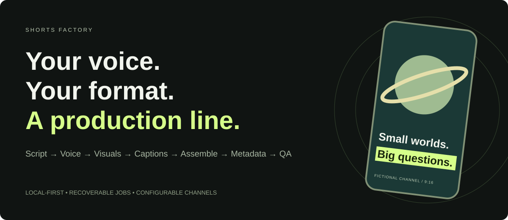

# Shorts Factory

### A production line for short-form stories.

Turn a channel profile into a narrated, captioned vertical video, with recoverable jobs and a local control room. Python 3.12 · uv · ElevenLabs · Pexels / Pollinations · faster-whisper · FFmpeg · FastAPI.

[Explore the interactive showcase](https://1zoz1.github.io/shorts-factory/) · [How it works](#how-it-works) · [Local operating guide](#local-operating-guide) · [Customization](#customization)



> Public documentation and interactive showcase of an existing local application. Runtime source and production data are not distributed here. The page uses a fictional example.

## How it works

The implemented production sequence is:

```text
Script → Voice → Visuals → Captions → Assemble → Metadata → QA
```

| Stage | Implementation |
|---|---|
| Script | An Anthropic-powered writer uses the channel's niche, editorial angle, narrator persona and length targets. |
| Voice | ElevenLabs narration with a channel-specific voice or an environment default. |
| Visuals | Pexels portrait footage when requested and available; generated images through Pollinations or the optional fal adapter. Stills receive Ken Burns motion. |
| Captions | Local faster-whisper transcription produces word timings and ASS karaoke highlighting. |
| Assemble | FFmpeg renders a 1080 × 1920, 30 fps MP4 with narration and burned captions. An optional local music track is mixed in. |
| Metadata | Generated title, description, tags and hashtags follow the channel profile. |
| QA | Structural checks cover output presence, file size, duration and caption presence. |

**Publishing is a separate action.** `shorts make` stops after QA. The CLI also exposes explicit YouTube and TikTok publishing commands. YouTube uses the profile's privacy setting and defaults to private when unspecified; scheduling is supported by the upload command. These are application capabilities, not features of this static site.

Completed stages are recorded in `data/<video_id>/state.json`; a SQLite index supports the local dashboard. Resume skips stages already recorded as complete. To regenerate an earlier stage, use a fresh job or deliberately reset the appropriate state and dependent outputs. Resume is not automatic cache invalidation after a profile change.

## Local operating guide

These commands apply to an existing local working copy of the application, not this documentation-only repository.

### 1. Prepare the runtime

Use Python **3.12** and uv. The current FFmpeg helper expects `tools/ffmpeg/bin/ffmpeg.exe` and `ffprobe.exe`; use a build with the ASS/libass subtitle filter enabled. The code was developed for Windows.

```powershell
uv sync
# The current local project uses Typer but does not declare it in pyproject.toml.
uv pip install typer
Copy-Item .env.example .env
```

Set the required Anthropic and ElevenLabs credentials in your local `.env`. Configure the narration voice. Add a Pexels key for stock footage; the image adapter defaults to Pollinations, with `IMAGE_PROVIDER=fal` available when configured.

### 2. Choose a channel and produce a review copy

```powershell
uv run shorts channels
uv run shorts make <channel-id> --until assemble
uv run shorts resume <video-id> --channel <channel-id>
uv run shorts serve --host 127.0.0.1 --port 8765
```

The local dashboard opens at `http://127.0.0.1:8765`. YouTube OAuth is an explicit `shorts auth` command; uploading uses `shorts upload <video-id> --channel <channel-id>`.

## Customization

A profile lives in `config/channels/<channel-id>.json`. Editorial identity changes without replacing the production engine.

| Profile controls | Effect |
|---|---|
| `niche`, `angle`, `voice_persona`, `hook_style`, `cta` | The channel's subject, point of view and writing voice. |
| `words_per_video`, `target_duration_sec` | Script length targets and the QA duration window. |
| `visual_style`, `image_style`, `use_broll` | Visual direction and the mix of stock footage and generated stills. |
| `voice_id`, `caption_style`, `hashtags`, `upload` | Narration, on-screen typography, packaging and publication defaults. |

The page demonstrates **Pocket Observatory**, a fictional science channel invented for this showcase. No production channel performance or financial results appear here.

For a more specialized production format, see [Kidsong Factory](https://1zoz1.github.io/kidsong-factory/): recurring characters, generated music and a lyric-aware storyboard show how the same staged approach can adapt to a different editorial product. It is a separate implementation, not a plug-in for this CLI.

## Scope and limits

- Implemented: staged video generation, persistent job state, local dashboard, explicit YouTube/TikTok adapters and upload scheduling support.
- Human review: QA is structural. Review the finished video, facts, media rights and packaging before publishing. Keep the local dashboard bound to loopback.
- Not claimed: autonomous trend research, automatic quality approval, guaranteed audience growth, monetization or a closed-loop optimization system. Provider access, quotas and terms depend on your own accounts.

## Public package

`README.md` is the operating and architecture guide. `docs/` contains the self-contained GitHub Pages site: HTML, CSS, JavaScript and original SVG artwork. There is no backend, telemetry, third-party font request or API call. Open `docs/index.html` directly or serve `docs/` with a static server. GitHub Pages can publish the `main` branch's `/docs` directory.

Production `.env`, secrets, channel profiles, media, statistics and revenue are excluded from the public package.
